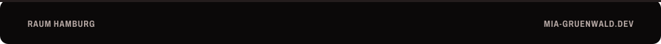

<a href="https://www.mia-gruenwald.dev"><picture><source media="(max-width: 600px)" srcset="bilder/kopf-schmal.svg"></picture></a>

Ich bin Mia und mache meine Ausbildung zur Fachinformatikerin für Systemintegration am Berufsbildungswerk Hamburg. Mit neun habe ich zum ersten Mal selbst Windows installiert, kurz danach lief TrueNAS Core auf einem alten Dell-Laptop, mein erster Server. Heute ist es ein HPE ProLiant mit Proxmox, auf dem meine Dateien, meine Passwörter und meine Fotos liegen.

Am liebsten baue ich Dinge, die für mich und die Leute um mich herum einfach funktionieren: eine Einkaufs-App für meine Freunde, ein Infoboard für die Schule, ein gemeinsames Tablet für meine WG.

<picture><source media="(max-width: 600px)" srcset="bilder/board-schmal.svg"></picture>

Auf dem Server laufen über 40 Container und VMs. Jede Nacht sichert der Proxmox Backup Server alles und spiegelt es auf ein NAS, Uptime Kuma meldet Ausfälle, und in NetBox steht, was wo läuft. Was von außen erreichbar ist, gebe ich einzeln frei. Die ganze Karte zum Durchklicken steht auf [meiner Website](https://www.mia-gruenwald.dev).

Ich entscheide, was gebaut wird, und prüfe, ob es stimmt. Beim Code arbeite ich mit KI, und das schreibe ich auch dazu. Ein Ergebnis zählt für mich erst, wenn ich es laufen gesehen habe.

Zurzeit bringe ich mir Elektronik bei, mit Mikrocontrollern und kleinen Einplatinenrechnern. Und wenn der Rechner aus ist, spiele ich Bass, E-Gitarre oder Akustikgitarre.

<a href="https://www.mia-gruenwald.dev"><picture><source media="(max-width: 600px)" srcset="bilder/fuss-schmal.svg"></picture></a>

[Website](https://www.mia-gruenwald.dev) &nbsp;·&nbsp; [E-Mail](mailto:mia_gruenwald08@outlook.de) &nbsp;·&nbsp; [LinkedIn](https://www.linkedin.com/in/mia-gr%C3%BCnwald-0114513b4/)
